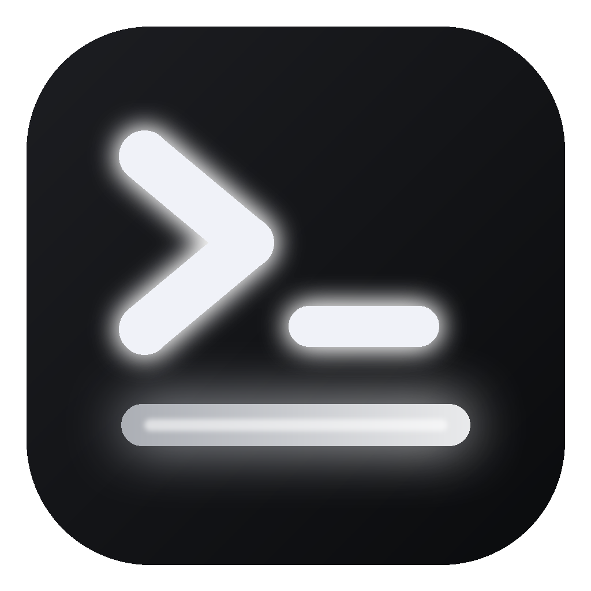

# Glowline

A local AI workspace for Windows: run **Claude Code**, **Codex**, **OpenCode**, **Antigravity** and more coding agents against **local models** (Ollama, LM Studio) or your own subscriptions and API keys, chat with any model, write prompts, and create **images, videos, upscales and voices** on your own GPU – all in one window with a live stats bar at the bottom.



## Express setup

On the first start Glowline looks at your PC (graphics card, VRAM, RAM, free space) and offers two ways:

- **Express** – pick a speed (**Fast**, **Balanced** or **Best quality**; the one that fits your PC is marked) and Glowline installs everything in one go: Ollama if it is missing, a **coder**, a **reasoning** and a **fast helper** model, plus the Studio models for **images, video, voice and upscaling**. Untick anything you don't want – the download size and free space are shown before you start. Optionally take the **uncensored (abliterated)** versions of the language models.
- **Custom** – set up everything yourself, like before.

| Speed | Coder | Reasoning | Fast helper |
|---|---|---|---|
| Fast | Qwen 3.5 4B (64k context) | Qwen 3 4B | LFM 3 1.7B |
| Balanced | Qwen 3.5 9B (64k context) | Qwen 3 8B | LFM 3 1.7B |
| Best quality | Qwen 3.5 35B (128k context) | Qwen 3 30B | LFM 3 1.7B |

Glowline saves each model with a fixed context size (e.g. `qwen3.5:9b-64k`) and tells Claude Code and OpenCode about it, so long sessions don't silently overflow. Afterwards the coder is the default in the terminal and the fast helper in Chat. You can open the setup again any time under **Models → Express setup**; it keeps running in the background if you hide it.

## What it shows

| | |
|---|---|
| **tok/s** | output speed, with a gauge and the session peak |
| **First token** | time until the first token arrives |
| **Prefill** | prompt processing speed (or `cached`) |
| **Prompt** | prompt tokens vs. the model's context window |
| **Output / Turn** | tokens of the last reply, duration of the current turn |
| **GPU power / VRAM** | live from `nvidia-smi` |
| **Saved costs** | what the same tokens would have cost with a cloud model – click it to pick Claude Sonnet / Opus / Haiku, GPT-5 or enter your own model and prices |

## How it works

Glowline starts a small measuring proxy on `127.0.0.1:3460`. The coding tools talk to that proxy, which forwards every request to Ollama or LM Studio and measures the stream on the way back. Ollama serves the Anthropic (`/v1/messages`) and Responses (`/v1/responses`) formats natively, so no extra router is needed.

- **Claude Code** – the real `claude` CLI with `ANTHROPIC_BASE_URL` pointed at the proxy. Switch models in the bar (uses `/model`).
- **Codex** – `codex --oss` with `CODEX_OSS_BASE_URL`.
- **OpenCode** – `opencode --standalone` with an injected OpenAI-compatible provider.
- **Antigravity** – Google's coding agent (`agy`), with your own Google account and its own models.
- **More agents** (fold-out group in the tool menu):
  - **Qwen Code** – runs on your Glowline model (local or an OpenAI-compatible API key) through the proxy.
  - **Gemini CLI**, **GitHub Copilot**, **Droid** (Factory) and **Cline** – started in your folder with their own account and models.
- **PowerShell** – plain shell, no model.

Tools that are not installed show their install command right in the terminal.

Models can be loaded/unloaded from the model menu. Press **F11** for fullscreen.

## Workspace

Everything lives in the tool menu at the bottom right – no extra windows.

- **Chat** – talk to any model, local or cloud. Thinking is shown separately and folds away.
- **Create right in the chat** – just ask: *“create an image of a tree”*, *“make a TikTok video of a dancing cat”*, *“read this aloud: …”*. Your chat model recognises the request, writes a better prompt and the Studio makes it on your GPU – the result appears in the chat. Follow-ups work too (*“make the sky purple”*), images get **Upscale 4×** and **Animate** buttons, and you can attach your own image with 📎 or drag & drop. Normal questions stay normal chat. Needs the Studio set up; small models (e.g. the fast helper) sometimes misread a request.
- **Prompt helper** – type an idea in plain words and get a ready prompt for video, image, voice or a coding task. Video/image prompts come with a negative prompt; **→ Create in Studio** sends them straight to the Studio, **→ Send to Claude Code** pastes a coding task into the running session.

## Accounts

Under **Models → Accounts**:

- **Claude subscription** (Pro/Max) – used inside Claude Code with your own login. Glowline only measures; it never reads your login.
- **ChatGPT account** (Plus/Pro) – used inside Codex with its own login.
- **API keys** for Anthropic, OpenAI, OpenRouter, Google Gemini, DeepSeek, Groq, Mistral and xAI (Grok) – their models then appear in the model lists for Chat, OpenCode, Qwen Code (OpenAI-compatible ones), Claude Code (Anthropic) and Codex (OpenAI). Keys are encrypted with your Windows login and only sent to their provider.
- **Higgsfield API key** – for cloud video in the Studio (see below).
- **Hugging Face token** (optional) – for gated model downloads.

"Saved costs" only counts local tokens.

## Studio

Images, video, upscaling and voice – running fully inside Glowline. The first time, **Set up Studio** installs a private engine (Python, PyTorch, [ComfyUI](https://github.com/Comfy-Org/ComfyUI) running invisibly in the background, about 5 GB) into `%LOCALAPPDATA%\Glowline\studio`. Then download only the models you want:

| | Model | License | Download |
|---|---|---|---|
| Images | FLUX.2 klein 4B – fast, 4 steps | Apache-2.0 | 16 GB |
| Images | Z-Image Turbo – photorealistic, good with text | Apache-2.0 | 21 GB |
| Video | Wan 2.2 5B – text or image to video, up to 5 s | Apache-2.0 | 18 GB |
| Upscale | Real-ESRGAN x4 | BSD-3 | 70 MB |
| Voice | Chatterbox Multilingual – speech + voice cloning, 20+ languages | MIT | ~4 GB |

**Cloud video (optional):** with a [Higgsfield API key](https://open.higgsfield.ai/api-keys) the Video tab also offers **Wan 3.0 Prime** and **Seedance 2.0** – up to 15 s with sound, no GPU needed. These run on Higgsfield's servers and are paid from your Higgsfield balance per second of video (the button says *(paid)*); a start image is uploaded to Higgsfield. Cancel is free while the job is still queued, and failed or filtered jobs are not charged. Coding agents can't start paid cloud jobs.

- **✨ Improve prompt** uses your chat model to turn a short idea into a strong prompt.
- Results appear in a gallery per tab: *Animate →* sends an image to Video, *Upscale →* to Upscale. Everything is saved under `studio\ausgabe`.
- Before a job, Glowline unloads language models from the GPU (8 GB is not enough for both) and frees the GPU again when you chat with a local model.
- Interrupted model downloads resume where they stopped.
- Only clone voices you are allowed to use.

### Studio tools for coding agents

When the Studio is set up, Claude Code, Codex, OpenCode and Qwen Code started from Glowline get the tools `generate_image`, `generate_video`, `upscale_image`, `text_to_speech` and `studio_status` (MCP on `127.0.0.1:3461`, protected with a random key per start). Ask your agent for "a 16:9 hero image for the landing page" and it renders it locally.

### Favorites and downloads

- The model button in the bar only shows your **favorites** (split into Ollama and LM Studio when you have both). Click **All models & downloads** to open the big model window.
- **My models** lists everything from Ollama and LM Studio with readable names (long Hugging Face names are shortened, the uploader is shown in grey, the full name is in the tooltip). Click ☆ to add a model to your favorites, Load/Unload it, or click it to switch.
- **Download** gets GGUF models from Hugging Face: 1) choose where it goes (Ollama or LM Studio), 2) search, 3) pick a model and a size. Sizes that fit your VRAM are marked. Ollama downloads it itself (`hf.co/<repo>:<quant>`); for LM Studio, Glowline saves the file into the LM Studio models folder. Downloads show progress and can be cancelled.

## Requirements

If LM Studio's server runs on another port (it moves away from 1234 when that port is taken), Glowline finds it by itself. If the server is not running, the model window has a **Start LM Studio server** button.

Glowline tells you what is missing: if a tool is not installed it shows the install command right in the terminal, and if no model server is installed or running it says so and links to Ollama / LM Studio.

- Windows 10/11
- [Ollama](https://ollama.com) and/or [LM Studio](https://lmstudio.ai) (server started) – Express setup installs Ollama for you; if one is missing, **Models** has a button that downloads its installer to your Downloads folder
- The tools you want to use (`claude`, `codex`, `opencode`, `agy`, …) on your PATH
- NVIDIA GPU for power/VRAM readings (optional) and for the Studio (8 GB VRAM or more recommended, plus 25–60 GB disk space for the models you pick)

## Build

```sh
npm install
npm start          # run from source
npm run dist       # build the installer -> dist/Glowline-Setup-<version>.exe
```

Older installers are moved to `dist/alt/` automatically.

## Config

`%APPDATA%\Glowline\config.json` – port, backends, default tool/model, chat model, the comparison model and token counter for "Saved costs", Claude Code environment, `studioOrdner` (another place for the Studio).
